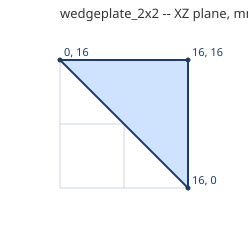
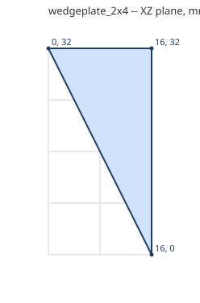
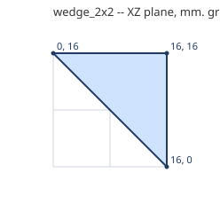
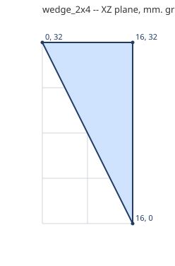

# Wedges

A plate or a brick cut corner to corner across its footprint, for an edge running diagonally in plan. Studs where the top is whole.

Generated by `tools/part_sheets.gd`. All sizes in **mm at print scale** (= Blender units,
see [README](README.md)); game metres are x43.75. Origin is the part's min corner:
X across the width W, Z along the length L, Y up. **Grid** is the envelope the game
uses; **real** is the outline to model, 0.1 mm in from the grid on every side.

| Part | Studs W x L | Plates | Grid W x L x H | Real W x L x H | Game m | Studs | Mass g |
|---|---|---|---|---|---|---|---|
| `wedgeplate_2x2` | 2 x 2 | 1 | 16 x 16 x 3.2 | 15.8 x 15.8 x 3.2 | 0.7 x 0.7 x 0.14 | 1 | 0.3 |
| `wedgeplate_2x4` | 2 x 4 | 1 | 16 x 32 x 3.2 | 15.8 x 31.8 x 3.2 | 0.7 x 1.4 x 0.14 | 2 | 0.4 |
| `wedge_2x2` | 2 x 2 | 3 | 16 x 16 x 9.6 | 15.8 x 15.8 x 9.6 | 0.7 x 0.7 x 0.42 | 1 | 0.9 |
| `wedge_2x4` | 2 x 4 | 3 | 16 x 32 x 9.6 | 15.8 x 31.8 x 9.6 | 0.7 x 1.4 x 0.42 | 2 | 1.2 |

## `wedgeplate_2x2`

- **Grid** 16 x 16 x 3.2 mm; **real** 15.8 x 15.8 x 3.2 mm; studs add 1.7 mm on top.
- **Studs on top** (1, Ø4.8 x 1.7 mm, centres x, z): (12, 12)
- **Underside tubes** (Ø6.51 outer / Ø4.8 inner, centres x, z): none
- **Profile** in the XZ plane (first number X, second Z), extruded along Y from 0 to 3.2 mm:
  (16, 0), (16, 16), (0, 16)

  

- **Orientations:** wedgeplate_2x2_y0, wedgeplate_2x2_y0_i, wedgeplate_2x2_y1, wedgeplate_2x2_y1_i, wedgeplate_2x2_y2, wedgeplate_2x2_y2_i, wedgeplate_2x2_y3, wedgeplate_2x2_y3_i

## `wedgeplate_2x4`

- **Grid** 16 x 32 x 3.2 mm; **real** 15.8 x 31.8 x 3.2 mm; studs add 1.7 mm on top.
- **Studs on top** (2, Ø4.8 x 1.7 mm, centres x, z): (12, 20), (12, 28)
- **Underside tubes** (Ø6.51 outer / Ø4.8 inner, centres x, z): none
- **Profile** in the XZ plane (first number X, second Z), extruded along Y from 0 to 3.2 mm:
  (16, 0), (16, 32), (0, 32)

  

- **Orientations:** wedgeplate_2x4_y0, wedgeplate_2x4_y0_i, wedgeplate_2x4_y1, wedgeplate_2x4_y1_i, wedgeplate_2x4_y2, wedgeplate_2x4_y2_i, wedgeplate_2x4_y3, wedgeplate_2x4_y3_i

## `wedge_2x2`

- **Grid** 16 x 16 x 9.6 mm; **real** 15.8 x 15.8 x 9.6 mm; studs add 1.7 mm on top.
- **Studs on top** (1, Ø4.8 x 1.7 mm, centres x, z): (12, 12)
- **Underside tubes** (Ø6.51 outer / Ø4.8 inner, centres x, z): none
- **Profile** in the XZ plane (first number X, second Z), extruded along Y from 0 to 9.6 mm:
  (16, 0), (16, 16), (0, 16)

  

- **Orientations:** wedge_2x2_y0, wedge_2x2_y0_i, wedge_2x2_y1, wedge_2x2_y1_i, wedge_2x2_y2, wedge_2x2_y2_i, wedge_2x2_y3, wedge_2x2_y3_i

## `wedge_2x4`

- **Grid** 16 x 32 x 9.6 mm; **real** 15.8 x 31.8 x 9.6 mm; studs add 1.7 mm on top.
- **Studs on top** (2, Ø4.8 x 1.7 mm, centres x, z): (12, 20), (12, 28)
- **Underside tubes** (Ø6.51 outer / Ø4.8 inner, centres x, z): none
- **Profile** in the XZ plane (first number X, second Z), extruded along Y from 0 to 9.6 mm:
  (16, 0), (16, 32), (0, 32)

  

- **Orientations:** wedge_2x4_y0, wedge_2x4_y0_i, wedge_2x4_y1, wedge_2x4_y1_i, wedge_2x4_y2, wedge_2x4_y2_i, wedge_2x4_y3, wedge_2x4_y3_i

