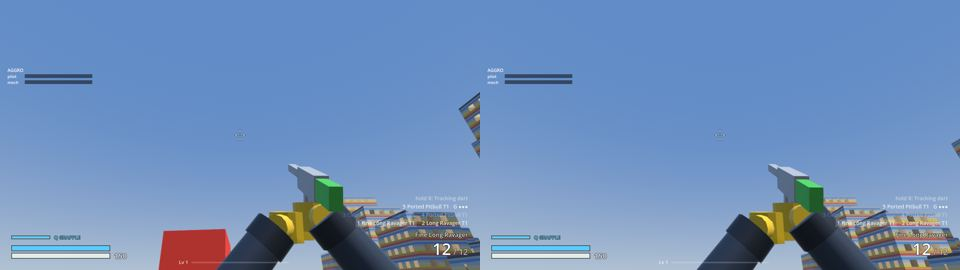
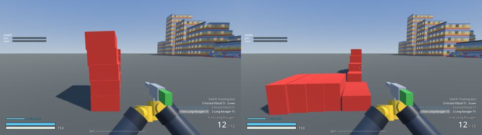
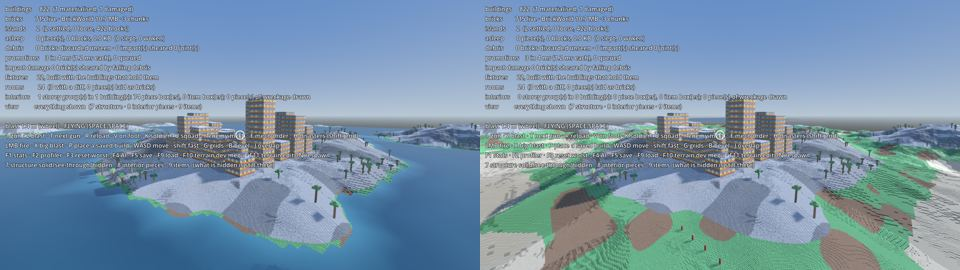
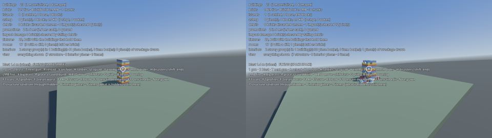
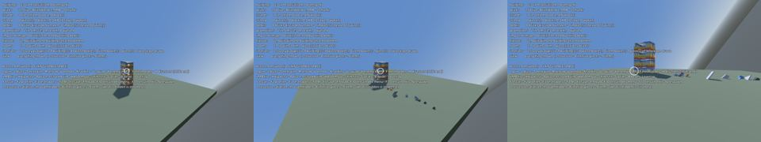
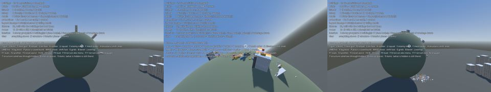
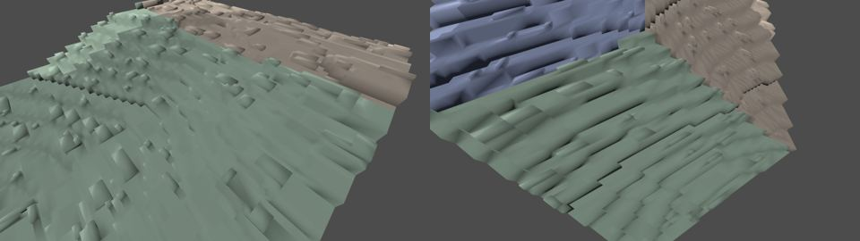
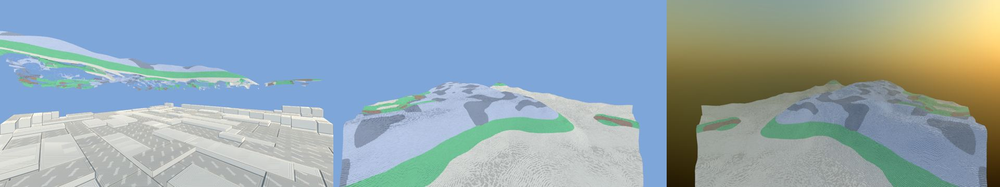
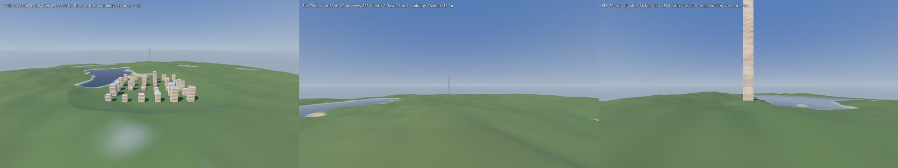
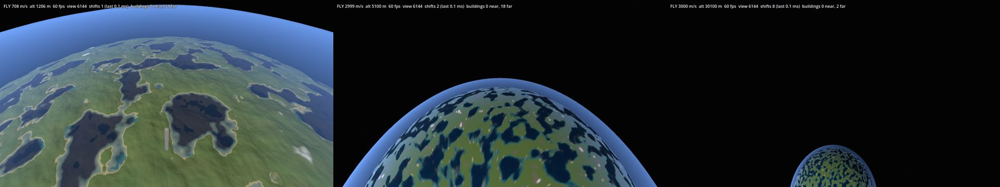

# Planets — real spheres, brick patches, buildings on their own grids

Status (2026-10-19): **design, not scheduled.** Replaces the 2026-10-05 version, which deferred
real planets because every system would have to change. Two decisions since then make the large
route much smaller:

* **The ground stops being a brick grid.** Smooth low-poly ground with sparse patches of bricks
  (Terrain.md 18.6 and §3 here) needs no global stud grid, so it does not have to wrap a sphere.
* **On a planet the ground is indestructible; buildings stay destructible.** The ground becomes
  baked static data, and everything destructible already lives on each building's own grid.

Prior art, both ours: STA (`C:\Users\lbaun\Documents\sta`: smooth SDF planets on Zylann's voxel
engine, radial gravity, floating origin, orbits, simple Gerstner water; its cubed-sphere study is
`Docs/23_CUBED_SPHERE_BLOCKY.md` and `25_PLANET_SHAPES.md`) and zylanntest's curvature shader
(`Docs/Reference/zylanntest.md`).

§9 lists what can be changed NOW, in the flat game, so the move costs less later.
Asteroids, ships, stations and bricks only where a building was hit: [Space.md](Space.md).

---

## 1. The two routes

| | cheap: a bent picture (§2) | large: real planets (§3–§8) |
|---|---|---|
| what it is | the flat world drawn falling away at the horizon | spherical bodies you land on, walk round and fly between |
| gameplay change | none | gravity, AI outdoors, terrain, coordinates |
| cost | days | months; much less after §9 |

---

## 2. The cheap route: bend the flat world in the vertex shader

Every vertex drops by its horizontal distance from the player squared over twice a radius
(zylanntest `shaders/blocky_terrain.gdshader`):

```glsl
vec3 d3 = world_pos - player_pos;
vec3 horiz = d3 - up * dot(d3, up);
VERTEX.y -= min(dot(horiz, horiz) / (2.0 * planet_radius), 10000.0) * strength;
```

`strength` blends in with the player's altitude, so the curve is faint on the ground and full from
the air, and 0 in an editor.

* **Gives:** a planet's horizon from any height for a few ALU a vertex. Gameplay, physics, AI,
  water, the city grid and saving are untouched.
* **Does not give:** going round, orbit, several bodies, gravity to a centre. Far things are drawn
  lower than they are: 4.5 m at 300 m on a 10 km radius -- fade the bend in past weapon range.

| R | drop at 100 m | at 300 m | at 1 km |
|---|---|---|---|
| 2 km | 2.5 m | 22 m | 250 m |
| 10 km | 0.5 m | 4.5 m | 50 m |
| 50 km | 0.1 m | 0.9 m | 10 m |

Applying it: one `curvature.gdshaderinc` with a global uniform, included by every world shader
(terrain tiers, studs, scatter, water, bricks, impostors, printed parts, glass). Traps: culling
uses unbent bounds (extra margin on far tiers); shadows need the include too. A few days.

It also makes a good LANDING transition for §3: from orbit you see the real sphere (STA's impostor),
and on the ground the bent picture of the local chart, the two agreeing at the switch altitude.

---

## 3. The ground on a planet: smooth low-poly, brick patches, never broken

### 3.1 Why bricks cannot wrap a sphere, and why that stops mattering

A quad grid closed round a sphere has at least 8 irregular corners (Euler: total defect `4χ = 8`;
STA doc 23 measured them). A stud grid laid round a planet is therefore never exactly a stud grid.

The ground Terrain.md 18.6 is heading to does not need one. It is a smooth low-poly surface with
**bricks in patches** -- flat ground and the odd scatter -- and each patch can carry its OWN little
grid, laid flat in the local tangent plane. The sag of a flat thing of width `w` on a sphere of
radius `R` is `w² / 8R`:

| width | R = 1.5 km | R = 6 km |
|---|---|---|
| 6 m patch | 3 mm | 1 mm |
| 40 m | 0.13 m (a plate) | 0.03 m |
| 70 m | 0.42 m (a brick) | 0.10 m |
| 140 m | 1.6 m | 0.42 m (a brick) |
| 300 m | 7.5 m | 1.9 m |

A brick patch of a few metres is flat to a fraction of a plate on any planet worth landing on.

### 3.2 The surface itself

A **cubed sphere of heightmap chunks** -- the same tiles we stream now, mapped through the sphere
on each of six faces, height measured outward from the centre, a LOD quadtree per face. STA
measured the mapping (doc 23 §4, §16, §26–32): cells square to within 4% except at the 8 corners,
which are hidden under terrain.

**Not** STA's voxel terrain. Zylann's SDF voxels are what made STA's planets destructible, with
caves and overhangs, and they are its most expensive system: transvoxel meshing, edit storage,
re-meshing. Indestructible ground needs none of it. Caves and overhangs, where wanted, are
authored meshes placed on the surface, like buildings.

### 3.3 What "indestructible" buys

| | today (flat, editable in the editor) | planet ground (static) |
|---|---|---|
| mesh | generated per tile while streaming | **simplified offline** per chunk -- flat ground collapses to a few triangles |
| collision | 100–200 merged boxes a tile | one heightmap shape a chunk, baked |
| lighting | sun shadow baked per vertex already | the same, plus baked AO |
| navigation outdoors | brick-column grid, read live | **baked once** per chunk (§7) |
| edit store | copy-on-write sculpt tiles | none at runtime |
| explosions | (already do not dig) | scorch decals |

Not a disk cache of raw tiles: measured, reading one back is slower than building it (§9.5). The
win is what can be done to ground that never changes -- simplified meshes, baked colliders and
navigation -- before anyone plays. Triangles: indestructibility does not remove any by itself; it permits offline
simplification. With the low-poly look (Terrain.md 18.6 follow-up) the near ground estimate is
~100–190k triangles where laid brick is ~400k; offline simplification of the far ground could
plausibly halve its ~370k again. **Estimates, not measured.**

### 3.4 Size decides the feel

Horizon distance `sqrt(2 R h)`:

| R | eye 1.7 m | mech 10 m |
|---|---|---|
| 1.5 km (STA's moon) | ~70 m | ~170 m |
| 6 km (STA's planets) | ~140 m | ~350 m |
| 10 km | ~180 m | ~450 m |

A mech shooter wants sight lines: 6 km or more for a planet you fight on; small bodies for
set pieces. STA's planets are 5–6 km with a 1.5 km moon.

---

## 4. Buildings: rigid grids, or bent grids

Every building already has its own brick grid and transform (`BuildingRegistry`, `b.xform`).
On a planet each one is placed in the local tangent frame at its site.

### 4.1 Rigid (the default)

The building stays exactly as it is; the ground comes to it: the pad and brick fill already built
for placing on hillsides (Terrain.md 21.8, 18.6), which is also what STA's structure builder does
(STA doc 16 §3, "flatten pad"). From the §3.1 table, no visible problem below about a brick of sag
-- ~70 m on a 1.5 km body, ~140 m on 6 km. Wider, the plinth shows at the edges as a terrace.

**The real limit is gravity, not the look.** On a flat 300 m roof on a 1.5 km body, radial gravity
is 5.7° off the roof's normal at its edges: the roof feels like a slope. The fix is a **gravity
zone per building**: inside its box, down is the building's down (Godot `Area3D` gravity override,
the Mario Galaxy way). With that, any width works rigidly.

### 4.2 Bent (for wide buildings on small bodies, and long things)

Render-only curvature, as asked: the bricks are never printed bent and the curve belongs only to
that planet's grids.

**Simulate flat, draw bent.** The building is simulated in its flat building space exactly as now
-- placement, damage, stress, collapse, rooms, AI -- and only drawn wrapped onto the sphere:

```
world(p_building) = centre + (R + p.y) * dir(azimuthal_map(p.x, p.z))
```

What that gives:

* **Gravity comes out right by itself.** Flat-space −Y maps to "toward the centre" everywhere, so
  the stress solver, the hang check and collapse need no change, and no gravity zone is needed.
* **No width limit in practice.** The azimuthal map's distortion over 300 m on a 1.5 km body is
  ~0.07%.

What it costs:

1. **Bricks widen with height** by `(R + h) / R`: 6.7% at the top of a 100 m tower on a 1.5 km
   body. Unavoidable on a sphere without gaps; invisible except beside an unbent copy.
2. **Collision cannot bend.** Each collision box gets its own small rigid transform (a box is a
   brick or a merged run, so its own bend is nothing). Chunk boxes, slab colliders, the roofs a
   player stands on.
3. **Everything that crosses between world and building space** -- bullets, `AIWorld`'s DDA,
   explosion radii, the placer's aim, debris breaking off -- converts through ONE pair of
   functions per building (`to_building(p)`, `to_world(p)`). Short rays go straight in building
   space; long ones in segments. **This is most of the work, and §9.2 makes it cheaper now.**
4. **Debris** that breaks off becomes an ordinary rigid body at its bent pose.
5. **Every drawing of a building bends the same way:** chunk meshes, instanced bricks, stud cards,
   shells, impostors, glass -- a few lines of vertex shader each, or bent at bake.
6. Two buildings never share one continuous wall: each is its own island (true today).

Rigid with a gravity zone is the default; bent is the tool for very wide buildings on small bodies,
and for long runs -- roads, walls, ring cities -- that would otherwise need a terrace every 70 m.

---

## 5. Gravity, controllers and physics

* **Bodies:** Godot's `Area3D` point gravity on each planet, an override inside each building
  zone. Rigid bodies (debris, falling bricks, ragdolls, loot) then need no code.
* **Controllers** (player, soldiers, mechs, vehicles, camera): local up = `-gravity_at(p)`.
  STA has a radial-gravity character controller (STA doc 05) to copy from.
* **Projectiles:** fall toward the centre; long shots curve over the horizon.

Today: 515 uses of `Vector3.UP` in 104 GDScript files (many are only `look_at` up-vectors) and
~21 hard-coded gravity constants. §9.1.

---

## 6. Coordinates, travel and water

* **Floating origin: STA has it.** `solar_system.gd` rebases the world every 500 m
  (`_rebase_distance`), and anything that must move with it joins the `origin_shift` group (its
  build system, goo and effects do). For us: everything on a planet lives in **that planet's
  local frame**; building grids are local to their buildings already, so a rebase moves the
  planet node and touches nothing inside them. The C++ that holds absolute positions --
  `AIWorld`'s spatial hash, `AINav`'s columns, `BrickWorld` chunk transforms, the registry's
  boxes -- either works in planet-local coordinates or joins the shift.
* **Seamless space travel:** STA's impostor and LOD tier swap (STA doc 02 §6–7) carries a planet
  from orbit to the surface.
* **Water: STA's simple water** -- Gerstner surfaces on a spherical shell at sea level, no flow
  simulation (STA doc 20). Our `BrickWave` plane waves run in the local tangent plane; pools stay
  per chunk. The brick-stepped wave look (Water.md) carries over as a shader.

---

## 7. AI and pathfinding on a planet

The hard part was always the outdoors: `AINav` is one flat grid of stud columns, height up.
Three things make it tractable:

1. **Buildings route by their rooms** (Docs/AI.md §3.6.1, worth doing in the flat game now): the
   inside of a building is a graph of spaces, openings and stairwells in **building space**, so
   curvature never reaches it.
2. **The ground is static**, so the outdoor map is baked once per chunk -- a flat grid in each
   chunk's own tangent frame (a cubed-sphere face chart), joined at chunk edges. The HPA* that
   exists (`ai_nav_hpa.cpp`) is already a graph of clusters joined at borders; a chunk is a
   cluster with its own frame.
3. **What stays live is small:** damaged rooms, wreckage and vehicles -- the brick grid, read
   locally, in the frame of the building or the chunk it is in.

Flow fields for swarms run on the chunk charts; a fight is a few hundred metres across, so it
rarely spans more than a few charts.

---

## 8. What happens to each system

| system | flat game today | on a planet | size |
|---|---|---|---|
| ground | brick heightfield, streamed | static cubed-sphere heightmap, baked, brick patches on local grids | large (new mesher path, reuses tiles) |
| buildings | own grid + transform | the same, tangent-frame placement; rigid + gravity zone or bent | small (rigid) / medium (bent) |
| destruction | building space | unchanged; debris under point gravity | small |
| gravity / controllers | +Y | local up | large, smaller after §9.1 |
| AI indoors | brick grid (room graph planned) | room graph, unchanged | none after AI.md §3.6.1 |
| AI outdoors | brick grid | baked per-chunk charts | medium |
| water | sea plane + pools | STA simple water on a shell | medium |
| coordinates | world space | planet-local + STA's floating origin | medium |
| saving / co-op | world positions | (body, local) positions | medium |

---

## 9. What to change now, in the flat game, to make the switch cheaper

Each of these is worth doing for the flat game on its own, or costs nothing in it. None changes how
the game plays.

### 9.1 One source of "up" and of gravity

`Gravity.up_at(p)` and `Gravity.at(p)` (an autoload, or statics on an existing one) returning +Y
and the project gravity today. Move the ~21 hard-coded gravity constants to it first, then the
`Vector3.UP` uses that mean "away from the ground" -- not the `look_at` up-vectors, which can wait.
Do it as files are touched anyway; no big-bang pass. Rigid bodies already take the project's
gravity, so they need nothing.

*Built 2026-10-20:* `scripts/gravity.gd` (`Gravity.down_at`, `up_at`, `at`, `strength`). Every
per-frame fall in the game goes through it -- pawn (walk, air, slide, grapple), titan, tank,
truck, flyer, debug camera, grenade, dart, VFX shards, rain and hail particles -- and every read of
the project's gravity (debris, danger volumes, the mech fall rule, the city's path-ahead). Each
system keeps its own magnitude. What is left is the `.y` logic round it -- "on the floor, zero the
vertical speed" and the like -- which becomes "along up_at" when a controller goes radial.

### 9.2 Building space through one door

Every query that goes from world space into a building -- `AIWorld`'s DDA, bullets, explosions,
the placer, debris -- should go through the building's transform (`b.xform` and its inverse), not
through `CityPlacer.box_of`'s "a building is on the grid at a quarter turn, so its box is an AABB"
(14 call sites, 7 of `on_grid`). Keep the AABB as a broad phase only. That makes buildings tilted
in a tangent frame free later, and a bent building one function swap.

*Built 2026-10-20:* `BuildingRegistry.to_building`, `to_world`, `own_box`, `contains`, `ray_hit`
-- the one door. `on_grid` snaps in `grid_frame_at(p)` (the world's frame today, the tangent frame
on a planet), so a building's grid follows the ground it stands on. `CityPlacer.box_of` is the
AABB round `own_box` and is documented as the broad phase; the placer's aim ray and the disaster
context's "which building is this point in" go through the building's own space. The other
`box_of` callers (earthquake, material effects, the city's pad and range checks) use it as a broad
phase or a footprint and are right as they are on the flat world; on a tilted frame they are the
list to revisit. The placer itself still snaps to the world's stud grid -- on a planet it will
snap in `grid_frame_at` too.

### 9.3 Room-graph pathfinding

Docs/AI.md §3.6.1. Faster and smarter in the flat game (fewer nodes, doors and stairs understood,
no materialising to route), and it is the half of planet AI that then costs nothing.

### 9.4 The low-poly ground with brick patches on their own frames

Terrain.md 18.6's follow-up: smooth low-poly ground almost everywhere, bricks in patches. Build the
patches as small grids with their own transform (as scatter and buildings are) rather than as
cells of the world's stud grid, wherever the look allows. On a planet those are exactly the
tangent-plane patches of §3.1. In the flat game it is also what lets a patch sit on a slope.

### 9.5 Bake the static ground

~~Cache built tile meshes and colliders to disk.~~ **Measured, not worth it (2026-10-20):** a tile
builds in 2.9 ms on a worker thread (chamfered 3.0 ms) and reading the same tile back from disk
(`bytes_to_var`, 198 KB) took 14 ms -- five times slower, and the build was never on the main
thread anyway: this month's hitches were in assembling nodes and uploading meshes, which a cache
does not touch. What §3.3 wants on a planet is OFFLINE SIMPLIFICATION of static ground, which is
planet work, not a cache.

### 9.6 Keep positions local where they are stored

Saves, the AI's caches and the registry store positions relative to a building or a tile where they
can. A world-space position in a save is the one thing a floating origin cannot shift for you.

*Built 2026-10-20:* `scripts/world_frame.gd`. A save and the damage log's wire form carry world
positions in the BODY's frame (`WorldFrame.to_body` out, `from_body` in): hit points of the
building commands, a resting piece's origin, every piece's transform in a checkpoint, the camera,
the placed builds and the hits still queued. Grid coordinates -- the piece commands, a region's
corners, LOAD's cells -- were never world positions and go as they are. `WorldFrame.origin` is
zero until a floating origin moves it; `tools/world_frame_probe.gd` moves it and checks each.

### 9.7 The bent horizon (§2)

Optional, days. It gives the planet look now and becomes the landing transition later.

### 9.8 One origin for everything keyed to the ground (from test 2, 2026-10-22)

Everything that looks the static field up by WORLD stud column broke under the shift: the terrain
streamer and coarse tier, the sea (wet cells, shore field, mask and seabed origins), SnowCover,
BrickHeap's cells and tops, and `AINav`'s columns and clusters. Give each one integer origin
offset, in studs (whole tiles), applied where a world position becomes a column -- as
`AIWorld`'s ground already does (`shift_origin`, built). In the flat game the offset is zero and
nothing changes; on a planet the shift becomes free for all of them, and `AINav`'s caches stay
warm (dropping them was 13 ms, and the searches after it cold).

### 9.9 Loose things fall along `Gravity.down_at` too (from tests 3 and 4)

§9.1 moved the controllers; the crumbs, the heap and IslandManager's support checks still use -Y
(the list is under test 4 below). On a planet they fell off a 60° pad and off a sphere's side.
Integrate crumbs along `Gravity.down_at`, find their floor along it, lay heap bricks square to the
local up in a cell of the local tangent frame, and turn the support rays, the nudge and the
rise/impact tests to it. Identical in the flat game.

### Not now

The cubed-sphere mesher, radial controllers, the per-chunk outdoor charts and the floating origin
are planet-only work with no payoff in the flat game: they wait for the decision to go to planets.

---

## 10a. Decision notes (2026-10-20): size, the sun, the story

### Size: past which nothing needs to know it is on a sphere

**Buildings never need bending at our sizes.** Rigid is invisible while the sag `w² / 8R` is under
a plate (0.14 m) and the tilt at the edge `w / 2R` under half a degree:

| R | widest rigid building | our towers (10–14 m) | a 300-stud build (105 m) |
|---|---|---|---|
| 1.5 km | ~25 m (tilt) | 0.016 m, 0.27° | 0.9 m sag: terrace or gravity zone |
| 6 km | ~80 m | nothing | 0.23 m |
| 10 km | ~105 m | nothing | 0.14 m |

Bent bricks (§4.2) are only for LONG things: a street grid, a wall, a ring city (a 1 km city sags
12.5 m at 10 km). Cities become districts on their own tangent frames, with the slopes ground
between them.

*2026-10-21: the bubble below is now the **alternative**; the chosen route is local down, §10b.*

**The AI, physics and controllers need nothing special if the simulation runs in a flat
bubble.** Instead of radial gravity everywhere, keep ONE flat frame for the active area -- the
floating origin plus a floating ROTATION, so the bubble's centre is at the origin with its up
along +Y -- and simulate everything in it exactly as today (every `Vector3.UP`, the `.y` logic,
`AINav`'s columns, the stress solver). The ground and buildings are drawn where they really are
on the sphere; the curve inside the bubble is just a gentle hill to the nav map (300 m out on
10 km is 4.5 m down). The only error is gravity: constant over the bubble where it should tilt
`d / R` at distance `d`:

| bubble radius | under 1° | under 2° |
|---|---|---|
| 150 m | R ≥ 8.6 km | R ≥ 4.3 km |
| 300 m (a mech's sight) | R ≥ 17 km | R ≥ 8.6 km |

So **~10–20 km planets** (moons ~5 km for set pieces) let the gameplay code stay flat. Re-anchor
the bubble when the FIGHT moves, not the player -- at a mech drop, a landing, between encounters
-- because a re-anchor moves every physics body (a hitch) and drops `AINav`'s columns and the
hierarchy's caches in the area (a cold search was 214 ms against 87 ms warm, §4.3 of AI.md).
Radial gravity is then only for the ship's flight, orbits, and things far from any bubble (frozen
or impostors).

What the bubble does not solve: **co-op players far apart.** Two bubbles 2 km apart on 10 km are
11° apart and cannot share one flat frame. Either missions keep the squad together (a leash of
~1 km), or each bubble gets its own physics space (Godot can run several) -- the second is real
work.

Horizon at 10–20 km: 180–260 m on foot, 450–630 m from a mech; the curve shows from the air (1 km up on
10 km the horizon is 4.5 km off and visibly round). Surface 1,250–5,000 km², procedural.

### The sun as the solar system's light

Never a real point light: an `OmniLight3D` at planet-to-sun distance has no usable shadows (six
cube faces, range and precision). The sun is **one `DirectionalLight3D` whose direction is set
from the sun's position relative to the bubble** -- what the game has now, so the ground's frame
cost does not change. What it changes:

* **The sun's height depends on where you stand**: 1 km on a 6 km body is 9.5° of sun. On a
  NON-rotating planet every place keeps its own time of day forever, and the baked terrain
  shadows (Terrain.md 19.9) stay free: each tile is baked with its own local sun direction.
* **A day/night cycle costs the bake.** Baking saved 1.6 ms a frame (4.9 → 3.3 ms, 19.9). A moving
  sun either re-bakes tiles near the player every few degrees (a tile is 2.9 ms on a worker) or
  has the terrain cast into the shadow map again (+~1.6 ms). The sky's radiance re-render on sun
  moves is extra (not measured; update every few degrees).
* **Night side** needs lights of its own; clustered omni lights are cheap, shadowed ones are not.
* **From the air and orbit**: an atmosphere shader on the planet's shell, about a full-screen pass
  (estimate ~0.5–1.5 ms at 720p on the Z1 Extreme, not measured), only while flying. Planets and
  satellites seen from space are impostors lit by the sun direction: nothing. An eclipse by the
  moon is an analytic sphere test in the shader: a few ALU.

Rough total: a fight on the ground costs what it does now; flight adds the atmosphere; a day cycle
adds ~1.6 ms or a re-bake schedule.

### What the story gets from real orbits

The story (enemy satellites change the weather and cause disasters; destroy them, then the moon
base) fits a **bounded system**: one planet, its moon, satellites on rails -- not free planet
hopping, which can come later on the same tech.

* **Satellites are real objects overhead.** A storm comes where a satellite's ground track passes:
  the player sees it rise, can time strikes, and a destroyed one falls as a burning streak.
  Satellites are brick builds -- destructible, with interiors, room graphs and marks, gravity
  off inside.
* **The mech drop is literal:** the player's ship is overhead and the drop is a fall from orbit
  into the bubble (the natural moment to re-anchor it). **Enemy reinforcements need their carrier
  overhead**, so killing the carrier cuts them off -- an objective the systems make, not a script.
* **The moon base is in the sky the whole game**, and can eclipse the sun.
* **Cost:** a ship flight mode (new code either way), orbits on rails (no n-body), the bubble and
  re-anchor, the cubed-sphere ground, districts on tangent frames. The flat game can fake most of
  the look -- an impostor ship overhead, drop pods from the sky, space as separate scenes -- but not
  the continuity or the satellite tracks.

## 10b. Decision (2026-10-21): local down, translation-only origin, single precision

The user: planets are spheres, curved everywhere with few flat areas; everything should have its
own down from where it is, bullets inheriting it, so on a big planet the downs barely differ and
nothing has to be re-centred the way the bubble is. Chosen over the bubble of §10a, which stays
the alternative.

### Local down: everything takes its down from where it is

| what | its down | work |
|---|---|---|
| debris, falling bricks, pieces, loot | toward the planet's centre: Godot point gravity on an `Area3D` | none: Jolt applies it per body |
| buildings (and their stress solve, hangs, collapse) | their own frame, square to the ground at their site (`grid_frame_at`, §9.2) | the solver already runs in building space; tangent placement is new |
| bullets, rockets, grenades | the shooter's down when fired, then straight | trivial. Over a 300 m shot on 10 km gravity's direction is 1.7° off: the drop is wrong by ~3% of itself, centimetres |
| players, soldiers, mechs, vehicles, the camera | `Gravity.up_at(p)` (built, §9.1) | ~6 controllers rebuild their whole basis from up every frame (STA doc 05: the strafe-drift fix); their `.y` logic becomes "along up" |
| the AI | the down of the **nav region** or building it is in | the big item, below |

**The AI through local frames.** The AI's code assumes +Y is up about 580 times (~280 `.y` and
~150 `Vector3.UP/DOWN` in `scripts/ai`, ~150 `.y` in the AI C++), and `AINav` is columns of studs
along world Y. Rather than change those, give each **nav region** its own flat frame and let the AI
see the world through the frame of the region it is in -- then nearly all of that stays true:

- A terrain tile is 32 studs (11.2 m): on a 10 km planet it sags 1.6 mm and tilts 0.06° across.
  A region of 8 x 8 tiles (90 m) sags 0.1 m (under a plate) and tilts 0.26°: flat to anything the
  AI measures. Regions are `AINav`'s HPA* clusters (`ai_nav_hpa.cpp` is already clusters joined
  at borders), each with its own transform; a path crossing a border crosses frames there.
- Inside buildings the AI routes by the room graph in building space (`BuildingLayout`, §9.3) --
  no curvature ever reaches it.
- `AIWorld`'s queries (line of sight, DDA through bricks) already go into a building through its
  own transform (§9.2); between buildings a ray is a ray.

Every region is in effect a small flat bubble that **never moves** -- so nothing is re-anchored and
no cache goes cold when the fight moves.

| | bubble (§10a, the alternative) | local down (chosen) |
|---|---|---|
| controllers | unchanged | ~6 rebuild their basis from up |
| AI | unchanged | nav regions with their own frames (large); most AI code unchanged |
| re-centring | rotate + move the whole area: a hitch, `AINav` caches dropped (214 vs 87 ms) | translation only, rare, nothing recomputed |
| co-op players apart | leash ~1 km or a second physics world | anywhere (precision aside, below) |
| gravity error | 1-2° at the bubble's edge | none |
| long shots | straight in the bubble | straight, with the shooter's down |

### Precision: one origin, moved by translation only

The direction of down no longer needs re-centring; **precision** still does. With the origin at the
planet's centre the surface is 10-20 km out, where a 32-bit float steps 1-2 mm. Godot's guidance
(Large world coordinates) is about 2 km from the origin for a first-person game, ~8 km for a whole
open world on foot: past that, the gun and hands jitter and stacked bricks wobble in physics.

So: **one origin per planet, moved by translation only** -- STA's floating origin
(`solar_system.gd`, every 500 m) or zylanntest's `solar_system_manager.gd` (`shift_world`) --
when the player is ~4 km from it, at a quiet moment, and at 8 km whatever is happening. (Was ~2 km
before test 1 measured nothing a player could see short of ~8 km: half the shifts.) Nothing turns, so building
frames, nav regions and their caches are untouched; the cost is moving every body and node once.
What must follow the shift is whatever holds an absolute position: `BrickWorld` chunk transforms,
`AIWorld`'s spatial hash, the registry's boxes, `AINav` region origins (§6, §9.6).

**Orbits do not move the ground.** While anyone is on a planet, the planet is the fixed frame and
the sun and sky move round it (STA doc 12's two frames); the solar system's coordinates are only for
flight and the sky.

### Double precision: checked, not worth it (2026-10-21)

| | |
|---|---|
| builds | no official double builds: the editor and export templates compiled with `precision=double`, then `--dump-extension-api` and godot-cpp and our extension rebuilt against it (`custom_api_file`, as Terrain3D documents) -- again at every Godot upgrade, and for every chat's worktree and the test binary |
| physics | Godot's Jolt module defines `JPH_DOUBLE_PRECISION` in a double build (`modules/jolt_physics/SCsub`): positions double, velocities, rotations and the broad phase still float; Jolt's docs: **5-10% slower** |
| rendering | camera and object translations are emulated as two floats (a small cost); **shaders stay single** -- our 8 shaders that use world positions (terrain, water, studs, impostors) would still jitter far out unless rewritten camera-relative |
| our C++ | `Vector3` / `Transform3D` become double: mesh arrays double on the CPU (the GPU stays float); ~1,000 explicit `float`s in the extension to check for places that drop the precision again |
| co-op | server and clients must run the same build |

It pays only for co-op spread across a whole planet with no other answer, or seamless space without
any shifting. Translation-only shifting does the job for 10-20 km planets.

### How other games do it

- **Minecraft Java** keeps entity positions in 64-bit doubles and draws relative to the camera; its
  own simple physics is all doubles, so it never shifts an origin. Jitter still showed from
  ~40,000 blocks in older versions. **Bedrock** uses 32-bit floats and jitters from ~131,000
  blocks. We cannot copy Java's way directly: our physics is Jolt, in floats.
- **Unreal's** ordinary origin rebasing does not work in multiplayer (server and clients cannot
  have different origins); its multiplayer rebasing sends positions in an absolute frame.
- **Networking SDKs** (coherence for Unity): the server holds absolute 64-bit positions, each client
  has its **own** floating origin and works in 32-bit near it. The catch they all name: the
  server's own physics cannot run in 64-bit with a stock engine, so far-apart players need the
  world split into simulators, each near its own origin.

### Co-op players far apart: two origins

Yes, by the last pattern. **Each group of players gets its own region: its own origin and its own
physics space** (in Godot a `World3D` holds a physics space; a second one lives in a viewport that
draws nothing), and the host simulates both. Positions on the wire and in saves are planet-local
(`WorldFrame`, §9.6 -- built), so each client places what it receives near its own origin.

- What sits in a region -- buildings, pieces, enemies -- belongs to it; something crossing between
  regions is handed over (the frame handoff STA uses for ships).
- When the groups come within ~2 km of each other, the regions merge into one.
- Local down makes it simple: buildings and nav regions are stored in their own frames, so a
  region's origin is only which point is at zero.
- Not yet checked: that Godot's Jolt runs two spaces independently (`PhysicsServer3D.space_create`).
  First test before relying on it. Until then, missions keep the squad within ~2 km.

### The far tier shows what still stands

Each far building is one instance of one MultiMesh (Impostors.md); it gains one number, its
**standing height**: the top of the highest storey still joined to the ground. Its top half gone,
the box ends at the break; a storey damaged in the middle with the top still standing, the whole
height (the scars in the facade data). Pieces that broke off are never in the far tier -- near,
they are pieces; far, asleep and hidden. The storey record of Space.md §5 is what gives the height.

### Bending

Rigid buildings on tangent pads are the default; at 10-20 km a 100 m building sags 0.14-0.9 m.
Bending (§4.2) stays possible and visual only -- the AI keeps the flat building -- for long things.

### Feasibility tests (2026-10-21)

Before any planet work: does anything break the route above? Prototype measurements only -- probes
and passes under `tools/`, nothing that changes how the game plays. Each ends **passed**, **problem
found** (with the size of the fix) or **plan-breaking**. Windowed runs one at a time, the heat log
read after each; timings only with the editor closed.

The scene passes run inside the city scene (it has the buildings, pieces, pawn, gun and AI wired
up) through one hook, `-- --planet=<test>`, that hands the scene to `tools/planet_passes.gd`; the
city scene gains those lines and nothing else.

**Tier 1 -- could break the plan**

| # | test | how | passes if |
|---|---|---|---|
| 1 | jitter at distance | a small brick scene -- one building, a stack of loose bricks, settled pieces, the pawn with arms and gun -- moved to 2, 8 and 15 km from the origin (along the diagonal, the worst case per axis) and left there. The camera strafes 1 mm a frame. Pictures of the viewmodel and of a brick 2 m away at each distance; per frame, the gun's transform relative to the camera (float32, as the GPU gets it) against its value at the origin; the stack's drift, its sleep state and Jolt's contacts over 20 s | at 2 km nothing a player could see; the doc's ~2 km shift distance stands |
| 2 | origin shift cost | the terrain city, debris settled, soldiers out; ONE frame moves everything by ~2 km in whole 32-stud tiles, through a reusable shift function. Measured: the frame's time, the sleeping bodies before and after, pictures before/after with the camera moved by the same offset (pixel difference per shader), and a list of every place that holds an absolute position | under the user's guess of 5-30 ms; no wake storm; no visible change, or a known fix; every holder listed with its fix |
| 3 | tilted building, point gravity | a tower on a pad tilted 7°, its frame square to the pad; an `Area3D` with point gravity toward a centre 10 km below the pad. Shoot it, blast it, collapse it, let it settle | the solve, hang check, pieces, sleep and collision work in the building's frame; every remaining "AABB / world grid" assumption listed with its size |
| 4 | debris and gravity reads | grep: every read of fixed gravity or +Y-as-down for loose bodies and VFX outside `gravity.gd`; then pieces dropped on a curved ground (a small sphere with point gravity, the curvature exaggerated) | pieces come to rest on the curve and sleep; the list sized |

**Tier 2 -- needed for the route, with fallbacks**

| # | test | how | passes if |
|---|---|---|---|
| 5 | walking round a sphere | a plain-mesh sphere planet, `Gravity` pointed at its centre (a test hook, off by default), the pawn and the mech on local down after STA doc 05's radial controller | strafing with no drift, jumping, slopes, mantling and the camera behave; a full great-circle loop ends where it began |
| 6 | cubed-sphere ground | our terrain tiles' meshes mapped onto a cube face edge and a corner by STA doc 23's mapping, with trimesh colliders | no visible seam, no collision gap, walking over the edge smooth |
| 7 | two physics spaces | two `World3D`s (the second in a viewport that draws nothing), bodies in both, stepped together | no interaction; the second space's cost measured |
| 8 | two nav regions | two flat nav regions 1-2° apart, each in its own frame, joined at a border; a path across | the joined path is continuous across the border and the AI's flat assumptions hold inside each |
| 9 | moving sun | frame cost of terrain casting real-time shadows against re-baking nearby tiles every few degrees (§10a "The sun": baked saves 1.6 ms; a tile bakes in 2.9 ms on a worker) | one of them affordable |

Results below, as each test is run.

**Summary (2026-10-22, tests 10-12 2026-10-23): nothing breaks the route.**

| # | test | result | fix size |
|---|---|---|---|
| 1 | jitter at distance | passed: invisible to 8 km, about a pixel on near objects at 15 km while turning; physics unchanged at 15 km | none (shift at ~2 km, as planned; 8 km would do) |
| 2 | origin shift | problem found: ~1-12 ms + AI, no wake storm; everything keyed by world column into the static field breaks | medium: one field origin per system (terrain, sea, snow, heap, AINav), the AI's stored positions |
| 3 | tilted building | problem found: solve, hangs, collision, pieces all right in the building's frame; crumbs and the heap fall along the scene's -Y | small-medium |
| 4 | gravity reads | problem found: pieces rest on curved ground; ~25 places in ~15 files still use -Y (crumbs, heap, support checks, VFX) | small-medium |
| 5 | walking round a sphere | passed (prototype walker); the pawn, mech and camera port is ~185 places | a week and a half |
| 6 | cubed-sphere ground | problem found: tiles map watertight; a 2D field cannot close a cube (1.3-1.7 m cliffs at cut edges) | medium: the field on the sphere |
| 7 | two physics spaces | passed | none |
| 8 | two nav regions | passed | none (HPA portals) |
| 9 | moving sun | passed: casting +0.06 ms GPU here; a full re-bake lands in 1.3 s with no frame cost | none |
| 10 | debris on planet ground | passed: trimesh ground costs the same as boxes, 400 loose bricks included | none |
| 11 | drawing curved ground | passed: the same as flat; a horizon cull saves 40% of the ground's GPU on foot | the cull: small |
| 12 | atmosphere from the air | passed: +0.8-1.1 ms GPU at 720p | none |

#### Test 1, jitter at distance: passed

`--planet=jitter`: the plain city's corner, the pawn with arms and gun beside a column of five
loose 2x4 bricks and a staggered wall, the whole scene moved by the shift of test 2 to 0, 2, 8 and
15 km from the origin along the diagonal (every axis that far: the float step is 0.12, 0.49 and
0.98 mm) and left there. Pictures are measured, not looked at: Lucas-Kanade over a fixed crop,
frame to frame, while the pawn strafes 1 mm a tick or the camera turns 0.11° a frame; for the
brick 3 m off, less the motion its exact projection predicts. Positive controls calibrate it: a
random 0.3 mm shake of the gun reads 0.089 px, 0.1 mm reads 0.039.

| | 0 km | 2 km | 8 km | 15 km |
|---|---|---|---|---|
| gun, strafing (px rms) | 0.001 | 0.000 | 0.001 | 0.001 |
| gun, turning (px rms / max) | 0.019 / 0.03 | 0.045 / 0.11 | 0.108 / 0.19 | 0.136 / 0.24 |
| gun, turning, as a shake of the gun | ~0.06 mm | ~0.15 mm | ~0.35 mm | ~0.45 mm |
| brick 3 m off, strafing | 0.055 | 0.052 | 0.065 | 0.046 |
| brick 3 m off, turning (px rms / max) | 0.010 / 0.02 | 0.012 / 0.03 | 0.017 / 0.04 | **0.261 / 0.47** |
| stack: asleep at tick, woke in 20 s, crept | 105, 0, 0.00 mm | 173, 0, 0.00 | 30, 0, 0.00 | 70, 0, 0.00 |
| stack: bottom brick's contact depth | 34 mm | 28 | 11 | 10 |

- **Strafing never jitters**, at any distance. Within one binade the float grid is uniform, so
  the camera and everything it carries round to the same offset wherever it is: the gun is a fixed
  fraction of a millimetre off, not shaking. CPU-side, the gun's transform relative to the camera
  and the brick's projected position came out exact at every distance for the same reason.
- **Turning is where it shows**, because rotation mixes the big translation into every component.
  The gun stays under a fifth of a pixel even at 15 km. The near brick is clean to 8 km and jumps
  at 15 km (the next binade, 8,192 m per axis) to a quarter of a pixel measured -- by the gun's
  controls about a pixel of real shimmer on near geometry.
- **Physics: no difference to 15 km.** The stack sleeps and never wakes, creeps 0.00 mm, and its
  contacts sink no deeper far out than at the origin; three headless repeats gave identical
  numbers at every distance. (One windowed run toppled the column at 15 km; the headless repeats and
  the other windowed run did not, and a ten-high column toppled at the origin as readily: loose
  boxes 0.7 m deep are simply unstable.)
- The pieces of a collapse next door settled at every distance (2 of 2).

So the 2 km shift distance is conservative: nothing a player could see happens before ~8 km.




#### Test 9, the moving sun: passed

`--planet=sun` on the terrain city, windowed, the editor closed and no other Godot running, a
street-level view; the renderer's own clock (`viewport_get_measured_render_time_*`) and each
frame's wall time, 300 frames a case:

| | render CPU ms (mean / worst) | render GPU ms (mean / worst) | frame wall time (mean / worst) |
|---|---|---|---|
| A baked, the sun still | 0.82 / 1.33 | 11.11 / 12.00 | 16.7 / 22.1 |
| B the terrain in the shadow map (radius 3: 49 tiles), the sun turning | 0.81 / 1.24 | 11.17 / 13.40 | 16.7 / 24.0 |
| C one re-bake of all 277 detail tiles, the sun 2° on (three runs) | 1.11-1.28 / 1.85-4.51 | 11.18-11.19 / 12.5-13.1 | 16.6-16.7 / 22.4-23.0 |

- A re-bake of every detail tile **lands in 1.23-1.37 s** (74-82 frames) on the workers, with no
  change in frame time and +0.3-0.45 ms of render CPU while the tiles upload. At 2° a step that
  is a day of 4.5 minutes before re-bakes overlap; a real day is far slower.
- Casting instead costs +0.06 ms of GPU on average here (Terrain.md 19.9 measured 1.6 ms on the
  heightfield scene, whose view sees far more ground). Either is affordable; baking keeps the
  worst frame lower. The coarse tier was not re-baked (its shadow is the far ground's, and it is
  rebuilt by ring -- §19.11).
- The process-time monitor read 22-23 ms throughout and does not separate the cases.

#### Test 2, origin shift: problem found (fixes small to medium), not plan-breaking

`tools/planet_origin.gd` -- `shift(city, offset)`, one frame, whole 32-stud tiles (11.2 m). It moves
every Node3D with no Node3D above it (children follow) and resets their physics interpolation;
the static bodies that live only on the physics server (shells, rooms, bands, terrain tiles, the
sea); every BrickWorld chunk transform; the registry's building transforms; the AI (new C++
`AIWorld.shift_origin`: proxies, cover, smoke, danger, and the ground asked at the shifted stud
column); drops `AINav`'s caches; and moves `WorldFrame.origin` the other way.

Checked by asking the scene the same questions before and after, moved by the offset (1.41 km X,
1.41 km Z): 600 random physics rays, 200 AI lines, a path across the city, the sleep census.

| | plain city (22 buildings) | terrain city (822 registry entries, 277 tiles, sea) |
|---|---|---|
| rays the same | 600 / 600 (worst 0.84 mm) | 599 / 600 (one tile collider at the streaming edge), worst 0.10 mm |
| AI lines the same | 197 / 200 (3 off by 0.01 of a proxy brick: rounding) | 199 / 200 |
| path across the city | the same 97 points, 216.6 m | -- |
| sleep | 22 Jolt-asleep bricks stay asleep, 2 settled pieces stay frozen, 0 woken | the same |
| pictures (plain city, 3 views) | 0.00 / 0.75 / 1.08 % of pixels differ (two shots before it: 0.01 / 0.11 / 0.00 %) | the sea vanishes (below) |
| first frame after it | identical to before: no interpolation smear | |

**No wake storm.** Moving a sleeping body's transform does not wake it in Jolt, and the city's own
"sleep" (a settled piece is frozen, a quiet one dormant as a record) is untouched.

**Cost.** The user's guess of 5-30 ms holds at the low end. The prototype found the server-only
bodies with one 30 km shape query (9-250 ms, not counted: a real shift keeps a list).

| step | plain | terrain |
|---|---|---|
| nodes + interpolation reset | 0.7 ms | 4.0 ms |
| server-only bodies | 0.07 (23) | 0.9 (532) |
| chunks, registry | 0.03 | 0.45 |
| AIWorld shift + sync | 0.03 | 7.0 |
| AINav caches dropped | 13.2 (warm with one 216 m path) | 0.03 (empty) |
| frame with the shift | 26.8 ms against 13-22 round it | ~23 ms, +~12 |

The one thing that scales badly is dropping `AINav`'s caches: 13 ms for one path's worth, several
times that after a fight, then cold searches (127 ms against 21 warm here). **Fix (small C++):**
key `AINav` by field column with one integer origin at its boundary, as `AIWorld`'s ground now is
-- the shift is then free for it and the caches stay warm.

**What breaks: everything keyed by world stud column into the static field.** In the terrain city
the sea and the underwater tint vanish after the shift, because the water's wet cells, shore field
and mask/seabed textures are looked up at the new world column, where the field has dry land.
Ground, buildings, trees, bricks and their studs are unchanged (the shift is whole tiles, so the
world-space stud lattice of the terrain and brick shaders lands on itself).



(A rerun on 2026-10-22 gave the same: 599 / 600 rays, 198 / 200 lines, 32-42% of pixels in the
terrain views changed, all of it water; the shift itself 10.0 ms.)

What holds an absolute position and must follow a shift:

| where | what | fix |
|---|---|---|
| BrickWorld (C++) | chunk transforms | loop over chunks (done in the shift) |
| AIWorld (C++) | proxies, cover, smoke, danger, ground cache | `shift_origin` (built) |
| AINav (C++) | columns and clusters keyed by world stud; pending path and cover requests (goal, path, breaches); water level is absolute Y; columns count plates from y = 0 | field-column origin (small); a vertical shift needs the nav regions' own frames (test 8) |
| BrickTerrain (C++), TerrainStreamer, TerrainCoarse | the field is sampled at world stud columns; tiles keyed by world tile | one integer tile origin in the field, applied at every world-to-column conversion (medium-small, terrain area); the streamer was frozen for the test |
| sea and water (BrickWave, water_sea / sheet / surface) | wet cells, shore field, `snapped_origin`, `seabed_origin`, `pool_mask_origin`, `hole_centre` | the same field origin (water area) |
| SnowCover, BrickHeap | squares and heap cells keyed by world XZ; heap `_tops` height per world stud | the same |
| IslandManager | crumbs' positions and floor heights, dormant records (`ChunkRecord.xform`, box) | shift them (small) |
| MultiMeshes with world instance transforms (crumbs, heap, joined pieces) | nodes moved by the shift, but later writes are world positions | keep those nodes at identity and shift the instances, or write positions relative to the node |
| swarm (C++) | ~17 world positions: rows, goals, lattice and field origins | shift (small) |
| ImpostorSet (C++) | instance transforms | shift (small) |
| GDScript AI and gameplay | ~180 typed position/vector members in 76 files, about half positions: goals, paths, rally / breach / cover points (soldier 11, mech brain 12, vehicles ~10, squads, commander), danger and airspace boxes, storm paths, ledge and hook points | STA's `origin_shift` group: each holder adds the offset (mechanical, 1-2 days), or shift only between encounters and re-plan |
| GPU particles in world space | the emitter moves, live particles stay | accept at a quiet moment, or restart |

#### Test 3, tilted building under point gravity: problem found (small to medium), not plan-breaking

`--planet=tilt [--tilt=7]` (`tools/planet_tilt.gd`): a 70 m pad in a tangent frame, an `Area3D`
with point gravity toward a centre 10 km below the pad (replacing the project's), a 16 x 16 tower
of 30 courses registered as any is and then **re-framed onto the pad** -- `on_grid` would have
snapped the tilt away, since `grid_frame_at` is still the world's frame. Shot (six small blasts up
a face), then its ground storey blasted out, then left to settle. Run at 0° (the baseline), 7°
(a building 1.2 km round a 10 km planet) and 60°: with a translation-only origin the scene's axes
never turn, so most of a planet is further round than 7° -- 60° is the honest case.

| | 0° | 7° | 60° |
|---|---|---|---|
| stands when made bricks (752) | yes | yes | yes |
| chunk gravity | grid -Y | grid -Y | grid -Y |
| shot: bricks left | 686 | 686 | 686 |
| collapse settles | 135 ticks | 139 | 190 |
| the falling section | 1 piece, on the pad, frozen | the same | the same |
| crumbs laid on the heap | 207, flat on the pad (0.0°) | 204, **turned 7.0°** from the pad | 222, **median 32 m below the pad**, 36° off: they fell along world -Y |
| AI line square through it | 2 bricks | 2 | 2 |
| AI: stand on its ground floor | -- (baseline) | as the baseline | snap moves it 60 m: columns run along world Y |




- **Stress solve, hang check, collision: work in building space at any tilt.** The solve and the
  hang rule run in the chunk's own grid, and a building on a tangent frame has its grid -Y along
  local down, so the default chunk gravity is right. (`set_chunk_gravity` snaps the world's down to
  the nearest grid axis: past 45° that would be a building on its side -- but nothing should ask it
  for a standing building, whose down IS its grid -Y.) Shells and bands collide where they are
  drawn.
- **Pieces: work.** Jolt applies the area's point gravity to every loose body; the falling
  section lands on the pad and settles, at 60° as at 0°.
- **Crumbs and the heap: broken past a few degrees.** They are integrated along world -Y with a
  floor height found by a ray down -Y, and laid flat in the world (`BrickHeap`, IslandManager
  ~1900-2160). Fix: integrate along `Gravity.down_at`, floor along the local down, lay square to
  the local up, heap cells in the tangent frame -- small to medium.
- **IslandManager's support checks** (rays down -Y `SUPPORT_REACH`, `SUPPORT_NUDGE`,
  `MAX_RISE_SPEED` on `.y`, impact on `linear_velocity.y`, `_wake_resting_on` comparing box Y) did
  not misbehave here -- the section landed flat on the pad -- but each is a -Y assumption that a
  piece resting on a slope will meet. Same fix, same list as test 4.
- **The AI's view:** lines go into the building through its own transform and count the same
  bricks at any tilt. Navigation does not: `AINav` columns are along world Y, so on a tilted floor
  it finds no standing place -- the room graph (§9.3) and nav regions in their own frames (test 8)
  are what fix it.
- **Code still assuming the AABB or the world grid:** `on_grid` / `grid_frame_at` (must return the
  tangent frame), the placer's snap, `_index_building` (an XZ hash of the 8 corners: fine as a broad
  phase), and the `box_of` callers -- the placer (2), the city (4: pad and range checks, a fall
  line), the disaster context (3), the earthquake (3), material effects (1). All are broad phases or
  footprints that work on a tilted box's AABB, but a fall line or a "which building is this point
  in" through them must go through `BuildingRegistry.contains` instead.

#### Test 4, fixed gravity and +Y-as-down for loose bodies and VFX: problem found (small to medium)

**Pieces come to rest on curved ground.** `--planet=tilt --ground=sphere`: a 40 m sphere (the
curvature 250 times a 10 km planet's) with point gravity to its centre and a 12 x 12 tower in the
tangent frame at 0°, 45° and 90° round it, each brought down and its fallen section broken up
again where it lay.

| tower at | pieces | settled | centres over the ground | laid bricks near it | their faces off the ground's |
|---|---|---|---|---|---|
| 0° | 2 | 2 | -0.65 .. 2.14 m | 192 | median 5.4° (the small sphere's curve) |
| 45° | 2 | 2 | 2.08 .. 2.16 m | 60 | median **42.8°** |
| 90° | 3 | 3 | -0.26 .. 2.12 m | **1** | 24° |

Of 820 laid bricks, 253 are on the sphere and **567 fell to the world's flat ground 50 m below**
(a windowed rerun: 251 and 574).


Rigid pieces are right everywhere (Jolt); crumbs and the heap are right only where the scene's -Y
is the local down.

What reads fixed gravity or uses -Y as down outside `scripts/gravity.gd` (loose bodies, VFX,
projectiles), ~25 places in ~15 files:

| file | what |
|---|---|
| island_manager.gd | crumbs: `v.y -= g * dt`, floor by a ray down -Y (`_crumb_floor`), laid at `floor_y`; support rays down -Y (`_under`), `SUPPORT_NUDGE` along -Y, `MAX_RISE_SPEED` and impact tests on `.y`, `_wake_resting_on` comparing box Y; `DEBRIS_GRAVITY` is a `gravity_scale` and follows the area (fine) |
| brick_heap.gd | lays flat in the world (`cols[up] = Vector3.UP`), piles by a height per world stud |
| ai/danger.gd, city_scene.gd (path ahead) | a falling piece's predicted path along -Y |
| autoload/vfx_pool.gd | shards fall along `Gravity.down_at` (right) but land on a `floor_y` plane |
| disasters: hailstorm, rain_splash | particle gravity `Gravity.down_at(Vector3.ZERO)`: the origin's down, not the emitter's |
| disasters: sandstorm, tornado, meteor_shower, acid_rain, lightning_storm, brick_fire | directions and ground rays along ±Y |
| ai/air_strike.gd | fall along -Y with its own `FALL_G` |
| loot/world_gun_pickup.gd, pawn/player_arsenal.gd | floor rays down -Y |
| tank, truck, debug camera, pawn, dart, grenade, flyer, titan | already `Gravity.down_at` (§9.1); their `.y` logic is the controllers' work (test 5) |

Fix: each takes `Gravity.down_at(p)` at its own position, and `Gravity` answers from the planet
(a point toward the body's centre). Mechanical, ~1-2 days; the crumbs and the heap are the part
that needs thought (a heap in a tangent cell).

#### Test 7, two physics spaces: passed

`tools/planet_spaces_probe.gd` (headless, `--fixed-fps 30`, frames flat out): a second `World3D`
in a `SubViewport` that never draws (`UPDATE_DISABLED`), and a pile of 400 boxes dropped onto a
floor in each **at the same coordinates**.

- The two piles come to rest identical to 0.000000 m and four boxes high (shared, they would be
  eight); a ray in the first space meets only its own bodies. The spaces are separate Jolt
  `PhysicsSystem`s, as Godot's module promises.
- Cost, per tick, while the piles fall (another chat's run was on the machine, so roughly):

| bodies | one space | two spaces |
|---|---|---|
| 400 (+ an empty second space) | 0.24 ms | 0.24 ms |
| 800 | 0.44-0.77 ms (two piles side by side) | 0.42-0.56 ms (400 in each) |

An empty second space costs nothing measurable, and a body costs the same in either: the second
region's cost is its own bodies. Asleep, both are 0.01 ms.

#### Test 5, walking round a sphere: passed (the port is the work: ~185 places)

Our pawn cannot walk a sphere as it is: it, its moves, its view, the titan motor, the mech and
the debug camera hold ~185 places of `.y` logic and `Vector3.UP/DOWN` (pawn 28, moves 73, view
18, titan motor 18, mech 22, debug camera 26). What the test answers is whether the radial
approach those would be ported to works with Godot's `CharacterBody3D` and Jolt at our sizes.
`tools/planet_radial_body.gd` is STA doc 05's controller with the pawn's numbers -- up from where
it stands, the whole basis rebuilt from it every tick, `up_direction` set to it, gravity and
jumps along it, the camera pitching only -- and `tools/planet_walk_probe.gd` walks it (headless,
28 checks, all pass):

| | pawn | mech-sized (7 m, 6 m/s) |
|---|---|---|
| 150 m planet (trimesh), a full great circle forward over both poles | off its plane 9 mm at most; ends 0.03 m from the start; feet on the ground every tick | 3 mm; 0.13 m |
| the same, strafing | 0.000 m off; ends 0.05 m away | 0.000 m; 0.14 m |
| camera roll over a loop | 0.000° | 0.000° |
| standing jump at the equator, 45°, the pole | 0.47 s, 0.51 m high, lands 0.000 m from where it left, at all three | the same |
| a 30° ramp / a 60° ramp | walked up (2.84 m) / refused | -- |
| 10 km planet, origin at the walker: 2 km forward, 2 km strafing | 0.000 m off its great circle | 0.000 m |

- **Strafing does not drift** when the whole basis is rebuilt each tick: STA's fix holds.
- **A walker must press into the floor** (a small velocity along -up when standing): at exactly
  zero, `move_and_slide` touches nothing on a convex surface and `is_on_floor` flickered on 10-50%
  of ticks while the feet never left the ground by more than 6 mm.
- One run of four on the 10 km planet (the pawn's first, forward) lost floor contact for its first
  29 s on Jolt's analytic 10 km `SphereShape3D`; the other three never did. Planet ground will be
  tile trimeshes (test 6), where nothing like it showed; worth a look before trusting a huge
  analytic shape.
- **Mantling, slides, wall runs, the grapple** are the pawn's moves (`pawn_moves.gd`, 73 of the
  185): not in the prototype. They are the same port -- "up" from `Gravity.up_at`, heights along it
  -- and the biggest single file of it.
- Size: the port is mechanical but wide -- a week for the pawn and its moves, two to three days for
  the titan, a day each for the debug camera and vehicles.

#### Test 6, cubed-sphere ground: problem found (the field must live on the sphere), not plan-breaking

`tools/planet_cube_probe.gd`: R = 10 km, STA doc 23's warp (blend 0.48), N = 1402 tiles a face
edge, real tiles from `BrickTerrain.build_tile` with every vertex mapped onto the sphere and the
mapped triangles as their collider. Each tile is also built unmapped in a second physics space,
and rays toward the centre on a 5 cm grid across each seam (13 mm off the stud lattice) are
compared, ray by ray, with a ray down through the flat twin at the same field point.

The faces are an unfolded net of the flat field, so across +Y | +X the field runs on unbroken (a
cube's 12 edges can be joined like this 5 at a time); at the corner, +X | -Z is a CUT: the two sides
come from different parts of the 2D field, as 7 edges and all 8 corners must.

| | rays | holes the flat game has not | height against the flat game's |
|---|---|---|---|
| a tile edge inside a face (the flat game's own seam) | 5,120 | 0 | median 0.4 mm, worst 1 mm |
| the face edge +Y \| +X | 5,120 | 0 | median 0.0 mm, worst 1 mm |
| the cut edge +X \| -Z at the corner | 2,460 | 0 | median 0.4 mm, worst 1 mm |



- **The mapping is watertight and faithful**: the two faces of an edge agree on it exactly, every
  mapped tile is the flat game's ground to within a millimetre, and nothing opens at a face edge.
- **Walking over the face edge is smooth**: the radial walker crossed it on its feet every tick, the
  biggest change in its speed along up 0.19 m/s (crossing an ordinary tile edge with a brick step
  in it: 1.39 m/s).
- **The cut edge has a cliff**: the two sides' field heights at the same point of the sphere differ
  by **1.26 m median, 1.68 m worst** (56 of 60 points). A 2D field cannot close a cube. **Fix:** the
  planet's field is a function of the point on the sphere (3D noise of the direction, pads and
  sculpts stored per face in their face's coordinates and blended across edges), and the mesher
  samples it through the map. Medium -- the terrain generator's planet mode, terrain area.
- **The warp changes the size of a tile**: 32 studs are 12.80 m mid-face, 9.09 m at an edge and
  8.57 m at a corner (1.49:1 linear, as STA measured), and at a corner the three tiles meet at 120°.
  Ground bricks then cannot keep the buildings' stud pitch: on a planet the ground is the smooth
  low-poly tier with **bricks only in patches on their own tangent frames** (§3.1, §9.4), not the
  stepped brick ground everywhere.
- The flat game's colliders are boxes per piece (`boxes`); the test used the mapped triangles. On a
  planet each box would need its own tangent rotation -- trimesh is the simpler collider there.

#### Test 8, two nav regions in different frames: passed

`tools/planet_nav_probe.gd` (headless): two regions of 8 x 8 tiles (256 studs, 89.6 m), each an
`AIWorld` + `AINav` of its own seeing its region in its own flat frame (the plane y = 0, a wall as
a proxy); region B turned 1.5° (and 0.5°) about the shared border, as the next tangent frame round a
sphere is. A wall in each forces a detour; the path is stitched at the best of 44 portals on the
border (A's length to it plus B's from it).

| | 1.5° (R 3.4 km) | 0.5° (R 10.3 km) |
|---|---|---|
| the path | 183.4 m, round both walls, crossing at z = 2 | the same |
| gap between the halves at the border, in the world | 0.000 m | 0.000 m |
| either half past the border | 0.00 m | 0.00 m |
| a region's plane against the sphere, at its corners | 0.59 m off, ground tilted 1.06° | 0.20 m, 0.35° |

- Each region's AI is the AI we have, unchanged: its frame turns everything into its flat world.
- **Borders on a stud line** (regions in whole tiles): with a 90 m region the halves met 0.3 m apart,
  because `AINav` answers in stud-column centres.
- The 44-portal search took 1.8 s -- the prototype's brute force. The real one is the HPA* graph
  (`ai_nav_hpa.cpp`): portals precomputed per border, as its cluster sides already are.
- At 10 km the flat regions are within 0.2 m and 0.35° of the sphere: flat to anything the AI
  measures. Under 5 km a region of 8 x 8 tiles is too big (0.6 m at 3.4 km) -- 4 x 4 there.

### Changes from the tests (2026-10-22)

- **Shift at ~4 km, never later than 8 km** (test 1), not 2 km.
- **Planets have smooth low-poly ground with bricks only in patches** on their own tangent frames
  (test 6): the cube's warp makes a 32-stud tile 12.8 m mid-face and 8.6 m at a corner, so a
  stepped brick ground cannot keep the buildings' stud pitch. §3.1 said so; now it is the rule.
- **The terrain field lives on the sphere** (test 6): a 2D field cannot close a cube (1.3-1.7 m
  cliffs at the cut edges). Noise of the direction; pads, sculpts and paint stored per face in its
  own coordinates and blended across edges. The biggest new piece: first in the order of work.
- **Nav regions are HPA* clusters of 8 x 8 tiles, borders on stud lines**, 4 x 4 under a 5 km
  radius; portals precomputed per border (test 8).
- **Prep in the flat game**: §9.8 (one ground origin) and §9.9 (loose things on `Gravity.down_at`).
- **Co-op players may be anywhere**: two physics spaces work (test 7); the ~2 km squad leash goes.
- Kept: single precision; the baked sun, re-baked for a day cycle (test 9).

### Performance tests before the conversion

The steady costs measured are small (tests 1, 5, 7, 9). Three are not measured and could change
the plan; they run before any of the order of work below.

| # | test | how | passes if |
|---|---|---|---|
| 10 | debris on planet ground | the city's collapse, its pieces landing on the ground as (a) the flat game's boxes per piece, (b) the same tiles as trimeshes (what a curved tile is), (c) trimeshes mapped onto the 10 km sphere. Physics time per tick while the pieces fall and settle, the worst tick, and settle time | (b) and (c) within ~20% of (a), or a box-on-tangent-frame collider is cheap enough to keep |
| 11 | drawing curved ground | the terrain city's ground drawn flat against the same tiles mapped onto a 10 km sphere, from street level and from 100 m up; GPU and CPU render time, draw calls, triangles; and what the horizon hides: the tiles and buildings past it | the curved ground costs no more than the flat; the horizon's saving measured |
| 12 | the atmosphere from the air | a full-screen atmosphere pass (single-scattering, a few samples a pixel) over the city at 720p, GPU time against none | under ~1.5 ms, the estimate in §10a |

#### Test 10, debris on planet ground: passed

`--terrain --planet=ground [--collider=boxes|trimesh]` (`tools/planet_ground.gd`), headless and
flat out (`--fixed-fps 30`, so a tick's wall time is its work), twice each. The terrain city's 178
collided tiles keep their boxes (35,507 shapes), or each swaps them for one trimesh of its drawn
surface (437,901 triangles in all) -- on the same flat ground, since curving a tile changes no
triangle count. Three towers brought down, the fallen sections broken up again, then 400 loose
bricks dropped over 20 x 20 m of hillside:

| ms a tick, mean / 95th / worst | boxes | trimesh |
|---|---|---|
| three towers coming down | 1.71 / 4.29 / 15.8 -- 1.63 / 3.38 / 17.5 | 1.49 / 3.18 / 20.0 -- 1.56 / 3.30 / 15.5 |
| the sections broken up | 1.34 / 2.64 / 12.5 -- 1.52 / 2.89 / 13.5 | 1.32 / 2.63 / 8.7 -- 1.31 / 2.81 / 8.3 |
| 400 loose bricks landing | 3.11 / 5.19 / 7.9 -- 2.40 / 3.51 / 5.3 | 2.31 / 4.57 / 8.2 -- 2.48 / 3.76 / 6.3 |

The same within run-to-run noise. (Another chat's `--ring` ran beside the brick drops.) The game
sends small debris to crumbs, which never touch the colliders, so only 4-8 bodies ever landed from
the collapses; the brick drop is the heavy case, and it does not care either. **Curved tiles collide
as their own triangles.**

#### Test 11, drawing curved ground: passed, and the horizon saves 40% at street level

`tools/planet_draw_probe.gd`, windowed, the editor closed, no other Godot: 33 x 33 detail tiles
(370 m square, 3.7 million triangles, the ground material, no studs) built flat and again mapped
onto a 10 km sphere mid-face, drawn from one edge looking across; the renderer's clock over 240
frames.

| | render CPU ms (mean / worst) | render GPU ms (mean / worst) |
|---|---|---|
| flat, street level (1.7 m) | 1.99 / 4.17 | 18.58 / 22.07 |
| curved, street level | 2.01 / 4.06 | 18.50 / 20.50 |
| curved, street level, horizon cull: **547 of 1,089 tiles hidden** | 0.87 / 1.44 | **11.19** / 12.51 |
| flat, 100 m up | 1.78 / 3.00 | 17.65 / 19.41 |
| curved, 100 m up | 1.89 / 2.82 | 17.91 / 20.26 |
| curved, 100 m up, horizon cull (none hidden: the horizon is 1.4 km off) | 2.57 / 4.93 | 18.03 / 20.47 |

- **Curved ground draws exactly as flat** (both runs).
- **The horizon is a saving we do not have now**: on foot, everything past ~180 m that is not a
  hill is under it, and a per-tile test (the tile's top against the eye's horizon angle) hides half
  of this patch and 40% of its GPU time. From the air it saves nothing near; it is the far tier and
  the coarse ground beyond 1.4 km that the curve then hides. (The absolute numbers are this probe's,
  detail tiles everywhere; the game draws coarse ground past four tiles.)
- The mapped tiles had to be rewound: the cube net's map mirrors them, and a back-face-culled
  material drew only their walls until it was.

#### Test 12, the atmosphere from the air: passed

`tools/planet_atmosphere.gdshader`: single scattering, Rayleigh and Mie, 12 samples along each view
ray to the depth buffer, 4 toward the sun from each, as a full-screen quad, over the flat patch from
100 m at 1280 x 720. **+0.76 and +1.11 ms of GPU** in two runs (17.78 to 18.89 ms), CPU unchanged:
inside §10a's 0.5-1.5 ms, and only while flying. Its look is unbalanced (a first pass, not tuned),
but its cost is the cost of the technique.



**Performance against the flat game, all measured:** a fight on the ground costs the same (tests 5,
7, 9, 10, 11) and, with a horizon cull, less to draw on foot; flying adds ~1 ms of atmosphere; a
far-apart co-op group adds its own bodies' physics on the host; an origin shift is ~10 ms once every
4-8 km of travel.

## 10. If it is taken up: order of work

1. **Flat-game prep:** §9.8 (one ground origin), §9.9 (loose things on `Gravity.down_at`). No
   change to how it plays; each makes a later step a function swap.
2. **The terrain field on the sphere** and the mesher sampling it through the cube map: smooth
   low-poly ground, brick patches on tangent frames. Gate: test 6 with no cut-edge step.
3. **Prototype planet:** that ground on a 10 km cubed sphere, baked; the radial walker; the
   translation-only shift at 4 km; one rigid building on a tangent pad. Gate: seams invisible, the
   face edge seamless underfoot, the roof level, no jitter after a shift.
4. Streaming and LOD per face; STA's impostor from orbit.
5. Buildings: tangent placement (`grid_frame_at` returns the tangent frame); destruction under
   point gravity (already works, test 3).
6. AI: room graphs (§9.3), nav regions as HPA* clusters in their own frames (test 8).
7. Controllers on local down: pawn and moves (~1 week), titan (2-3 days), debug camera and
   vehicles (a day each); the water shell; co-op in planet-local positions, a second physics space
   for a group far away (test 7).
8. Bent buildings, if long things want them.

---

## 11. The conversion (started 2026-10-23)

The user: go to planets, taking most systems from STA's smooth SDF planets, which already work;
the ground is indestructible, so none of STA's water physics; tall buildings appear as they crest
the horizon, not pop in; approaching from space, big buildings and features fade in, and the
largest are visible from orbit.

### 11.1 What comes from STA, and what changes

STA (`C:\Users\lbaun\Documents\sta`) builds a planet as one `PlanetUnit` node at the planet's
centre. Everything on the planet is its child in planet-local space, so a floating-origin rebase
moves that one node and nothing streams again.

| system | STA | here |
|---|---|---|
| ground | Zylann's voxel module (`addons/zylann.voxel`, MIT), `VoxelLodTerrain`, Transvoxel, clipbox streaming, `VoxelGeneratorGraph` built by `PlanetGraphBuilder` from `PlanetData` / `PlanetFields` | **taken**, with no edits: no stream, no edit tool, no caves. Smooth ground everywhere; a 3D field, so test 6's cube-edge cliffs never arise. Collision from the voxel mesher (`collision_lod_count` 1) |
| biomes, continents, oceans, mountains | `PlanetProfile` -> `PlanetFields`, one set of noises feeding the graph, the impostor and CPU height queries | **taken**, second pass (first pass: STA's simpler noise-layer path) |
| terrain shader | `shaders/terrain.gdshader`, with Transvoxel's stitch in the vertex stage (required) | **taken**; brick look comes later through §3's patches |
| impostor from orbit | sphere + baked heightmap + colour map, cross-faded with the voxel terrain by altitude (`tier1/tier2` 8% / 15% of R) | **taken** |
| atmosphere | a shell at 1.08 R | **taken**, with test 12's scattering pass for the air |
| streaming distance | horizon-based view distance (`_update_view_distance`: eye-to-horizon + horizon-to-peak) | **taken**, and the same rule drives buildings (§11.3) |
| floating origin | `_shift_world`: moves planets, star, player, `origin_shift` group | **ours**: `PlanetOrigin.shift` (tests 1-2), translation only, at 4 km; the planet node moves with everything else |
| gravity, controllers | `GravityBodyConfig`, radial controller (STA doc 05) | our `Gravity` answers from the planet; `tools/planet_radial_body.gd` until the pawn is ported |
| water | `WaterSystem` v3: flow graph, lakes, solver, ripple fields, CA | **not taken**. Only the ocean SHELL: a Gerstner surface on a sphere at sea level, shader only (STA's `water.gdshader` far tier), and "under it" is `radius < sea level`. No flow, no lakes, no simulation: the ground never changes |
| caves, granules, goo, vegetation | placed caves, 2 cm granules, goo, `VegetationInstancer` | not now (vegetation later, as our trees) |
| solar system, orbits, stations | `SolarSystem`, analytic orbits, anchored frame | later; one planet first |

### 11.2 Our buildings on it

Buildings stay ours: BrickWorld chunks, shells, storey units, the far tier. Each stands in the
**tangent frame** at its site (`BuildingRegistry.grid_frame_at` returns it on a planet), on a pad
the generator flattens: a smooth SDF plateau under each site, blended into the ground, so the
building's floor is level and its foundation meets the ground (test 3: the solve, hangs, pieces and
collision already work in the building's frame).

### 11.3 Buildings over the horizon: crest, don't pop

From an eye at height `h` over a planet of radius `R`, the horizon is `sqrt(2Rh)` away, and a
thing of height `H` past it shows its top once its distance is under
`sqrt(2Rh) + sqrt(2RH)`. So a building is **resident (drawn in its far tier) from just before its
own top can crest the horizon**:

    show_at(H) = sqrt(h (2R + h)) + sqrt(H (2R + H)) + margin

On foot on 10 km, a 10 m house shows from ~630 m, a 100 m tower from ~1.6 km, a 400 m spire from
~3 km -- each appears *below* the horizon and rises into view as the player walks, because the
ground (voxel terrain, or the impostor sphere further out) hides its foot. Tall buildings are
therefore loaded further out than short ones, by the same rule STA's streaming uses for peaks. The
near tiers (shell, bricks) keep their distance rings; only the far tier's range follows the horizon.

### 11.4 From the air and from space: fade in by size on screen

Above the ground the horizon is kilometres off and nothing hides a building's foot, so a building
**fades in by its size on screen**: a dithered alpha (as STA's impostor cross-fade) from 0 at about
1.5 px tall to 1 at about 4 px. At 720p and 75 degrees a tower 100 m tall is 4 px from ~12 km; a 400 m one from ~47 km.

- **Landmarks** -- the tallest buildings and the big features (a mega tower, a dam, a crater ring)
  -- are also drawn on the planet's impostor from space: baked into its colour and height maps
  (STA's impostor bake) and, the tallest, as a small marker instanced on the impostor shell that
  never fades below ~2 px, so a city reads as a glint of towers from orbit.
- A building's far box carries its standing height (§10b), so what shows from space is what still
  stands.

### 11.5 Order

1. `addons/zylann.voxel` into the project; check it loads beside `addons/brick` (Godot 4.6.2).
2. `scripts/planet/`: `PlanetData` (trimmed), `PlanetGraphBuilder` (noise path, no caves, plus site
   pads), the impostor baker; `shaders/planet_*`: terrain, impostor, atmosphere, ocean shell.
3. `scenes/planet.tscn` + `scripts/planet/planet_scene.gd`: one 10 km planet, `PlanetBody` (STA's
   `PlanetUnit`, trimmed), horizon view distance, impostor cross-fade, `Gravity` toward its centre,
   the radial walker, `PlanetOrigin.shift` at 4 km. Gate: walk, fly to orbit and back, no seams,
   no pops, no jitter.
4. Buildings on tangent pads, drawn by the far tier with §11.3's range and §11.4's fade; landmarks
   on the impostor.
5. Then the pawn and mech ported to local down, the AI's nav regions, storeys and destruction on
   the planet, biomes (`PlanetFields`), vegetation.

### 11.6 State (2026-10-23): a planet to walk on and fly from

Built (steps 1-4 of 11.5): `addons/zylann.voxel`; `scripts/planet/` -- `PlanetData`,
`PlanetGraph` (the generator), `PlanetImpostorBake`, `PlanetBody`, `PlanetBuildings`,
`PlanetWalker`, `PlanetFrame`, `planet_scene.gd`; `shaders/planet_*`; `scenes/planet.tscn`. Run it,
or `-- --gate` (9 checks, all pass, windowed and headless):

- the ground streams in under the spawn in 0.3-3 s; a 30 s walk never leaves the floor and stands
  exactly where the CPU says the ground is (`tools/planet_graph_probe.gd` holds the generator to
  the CPU within 6 mm, pads included -- both sample the relief on the datum sphere under a point);
- a cruise at 25 m passes a town (32 shells built) toward a 900-course spire 2.6 km off, which comes
  up over the horizon ahead;
- climbing to 30 km the voxel ground fades into the impostor (fade 0.62 at 1.2 km, 1.0 by 5 km),
  the origin follows in 8 shifts of 0.1 ms each, and the descent lands on the ground again;
- **no building popped in plain sight** (a fade jumping by more than a third while its top is over
  the horizon): they crest, then fade by size from the air.

What it is NOT yet: the pawn (the walker stands in for it), the AI, destruction (shells only, from
the city's `BuildingShell`, with their collision boxes), biomes (one ground palette), trees. The
worst frames are the first frame's shader compiles (~1.7 s) and the gate's own screenshots
(~100-200 ms each); a frame-time pass with the editor closed comes with the next step.




### 11.7 Porting the movers to local down (2026-10-23)

Pawn (and its moves, view, controller, the debug camera), titan motor and mech, tank, truck,
flyer, soldier. One rule everywhere: **"up" is `Gravity.up_at(position)`**, never `Vector3.UP`
or `.y`, through four helpers in `scripts/gravity.gd`:

| helper | flat game (up = +Y) | on a planet |
|---|---|---|
| `Gravity.vert(v, up)` | `v.y` | `v.dot(up)` |
| `Gravity.flat(v, up)` | `Vector3(v.x, 0, v.z)` | `v - up * v.dot(up)` |
| `Gravity.with_vert(v, up, x)` | `v` with `y = x` | its along-up part replaced |
| `Gravity.height_of(p)` | `p.y` | `|p - centre| - radius` |

In the flat game each is EXACT (a dot with (0, 1, 0) is `y`), so nothing there moves by a bit and
every existing probe still guards it. Bodies turn with the ground: a body's basis is carried along
the curve each tick (the minimal rotation from its old up to its new one, STA doc 05's full-basis
rebuild), so its local Y is up; look yaw and pitch are angles in that frame, not the world's.
Local offsets on a body (`Vector3.UP * eye_offset` on a child) stay as they are -- they are
already in the body's frame.

The AI's navigation stays on the flat grid until the nav regions (test 8) are built: on a planet a
soldier moves, turns and shoots in its local frame, but paths only inside one flat region.

**Where it stands.** Ported, each with the flat path kept literal wherever a helper is not exact
(`if Gravity.planet == null` / `if frame == Basis.IDENTITY`):

- **Pawn** (moves, view, controller, debug camera): body carried, look in the body frame; on a
  planet only, a standing body presses into the floor (`Gravity.standing_vert`) and an upward
  speed under 1.5 m/s on the floor is the ground rising (`Gravity.floor_rise`), which cured
  is_on_floor flicker on the voxel facets. `Pawn.frame_look` turns world look angles (what
  AimModel returns) into the body frame; `look_angles_to`, `look_dir` the same for a vector.
- **Titan** (motor, mech, brain, rodeo, fall rule, pilot, cockpit view): `motor.torso_basis()`
  is the torso frame everywhere.
- **Tank, truck, APC** (and Splatter, the deck, the brain's eye, brick debris, the chase camera):
  a carried `frame`, yaw measured in it.
- **Flyer**: ground from the planet's own height (`Gravity.ground_height`), orbits round the
  target in its tangent plane.
- **Soldier** (body side): steering, sight cone, aim, reach, waypoints, unstick ring,
  `body_fits`, breach plants, grenades, look.

Planet gates (scenes/planet.tscn, each body tracked with its own collision viewer,
`PlanetBody.track`): `--gate=pawn`, `--gate=mech`, `--gate=tank` (the player's tank: stand,
drive a great circle, turn about local up, stop, reverse, drop), `--gate=soldier` (an AI body
walked 40 m round the curve as walk_toward walks it, aimed through `frame_look`, `body_fits`).

**Not yet:** the soldier's brain on a planet (plan: 11.8) -- its nav, sight grid, cover and the AI world are
the flat game's C++ grid (needs the nav regions, test 8); `VehicleCover`, `VehicleNav`;
destruction on the planet; biomes and trees.

### 11.8 Plan: the AI's nav regions on a planet (2026-10-24)

The soldier's body is on local down (11.7); its brain is not: `AIWorld` and `AINav` (C++) and
the squad and tactics layer above them assume world +Y is up and read the ground from the flat
terrain's field. Test 8 showed a flat region in its own frame is flat enough at 10 km (0.2 m and
0.35° off the sphere for 8 x 8 tiles); this is how it goes into the game.

**N1. A frame for `AIWorld` and `AINav` (C++).** `AIWorld.set_frame(Transform3D)` -- region to
world. Every bound method takes and returns WORLD values: positions in through the inverse,
positions and paths out through the frame, directions (`field_dir`) through its basis, cover
results' points through the frame. Inside, everything stays the region's flat world: AINav's
own calls into AIWorld are C++ calls, never the bound ones, so they are not converted twice.
With the frame IDENTITY (the flat game) every wrapper takes the path it takes today -- no
transform at all, bit-identical, and every AI probe still guards it. The translation-only
re-centre (PlanetFrame) moves the frame's origin; nothing inside is recomputed.

**N1b. Ground from a grid.** `AIWorld.set_ground_grid(origin, step, w, h, heights)`: the
region's ground as heights in its own frame, one sample every 4 studs (1.4 m), read bilinearly
at a stud's centre in `_ground_plate` instead of `BrickTerrain::surface_plate`. The frame's
origin sits under the region's lowest ground, so its plates count up from 0 as the flat game's
do. Outside the grid the ground is a wall: a path never leaves its region. Built from
`PlanetData.height` (GDScript, ~65 000 samples for a 1024-stud region, about 0.3 s, off the
fight's path), the sea level from `PlanetData.sea_level` in the frame.

**N2. One region round the fight first.** `PlanetAI`: an `AIServices` whose world and nav see a
region of 1024 x 1024 studs (358 m; its corners tilt 1.45° and sag 3 m at 10 km -- the sag is
only ground height, the tilt is the AI's "vertical" 1.45° from the true one at the edge, 5 cm
over a body's height) centred on the player's town when the AI is set up there. Soldiers there
fight on it with their brains unchanged. Leaving it: no paths outside (N4 is the fix).

**N3. The squad and tactics layer on the Gravity helpers.** The GDScript AI still reads world
`.y` and `Vector3.UP` in about 280 places (most: wave_director 39, firefight_director 18,
building_layout 18, transport_truck 17, spawn_survey 13, air_strike 11, tactics_sense 8,
room_tactics 6). Ported as 11.7 ported the movers, the flat path exact or kept literal, file by
file, each file's own probes run before the next.

**N4. Many regions: HPA* clusters in their own frames.** Regions of 8 x 8 tiles on stud-line
borders (4 x 4 under 5 km radius), each the next tangent frame; portals precomputed per border,
the path stitched at them as test 8 did by brute force (1.8 s there; the precomputed graph is
what `ai_nav_hpa.cpp` already does for its clusters). Regions made round each player group as
it goes, dropped behind it.

**Gate (planet scene, `--gate=squad`):** a squad set down on the region walks to the player
round the curve, takes cover, fires; their paths stay on the ground (within a plate of
`PlanetData.height`); the flat AI probes unchanged after N1 and after each file of N3.

**Not here:** buildings' bricks in the AI's world on a planet (their own frames, 9.2), vehicle
nav (`VehicleNav`), `VehicleCover` -- after N2.

**11.8 state (2026-10-24):** N1b's GDScript half is built -- `PlanetNavRegion`
(scripts/planet/planet_nav_region.gd): a 1024-stud region's tangent frame and its ground as
257 x 257 heights in it, built in 222 ms; on the ground within 2.4 mm, 1.3 cm between samples,
corners 1.45° (tools/planet_nav_grid_probe.gd, 9/9).

**N1 and N1b's C++ half built (2026-10-24).** `AIWorld.set_frame(region_to_world)`: every
bound method of AIWorld and AINav is a thin `_b_` wrapper -- unframed it calls straight
through (no transform, the flat game bit-identical: the flat AI probes unchanged); framed,
positions in through the inverse, positions, paths, breaches, cover and peek points out through
the frame, `field_dir` through its basis, proxies, smoke and danger boxes into the region,
`invalidate_box` into the region with `nav_changed` still carrying the world box. AINav's own
calls into AIWorld are C++ and never converted twice. `sync()` puts chunks in the region;
framed, `shift_origin` moves the frame's origin and nothing inside. `top_at` / `ground_at`
stay region-local; their world forms are `ground_under(point)` (was `p.y = ground_at(p.x,
p.z)`, exact unframed) and `top_over(point)`. `set_ground_grid(origin, step, size, heights)`:
`_ground_plate` reads the grid bilinearly at the stud's centre; outside it the ground is a wall
256 plates over the region's highest ground. Probe `tools/planet_nav_frame_probe.gd` (headless,
18/18): a framed path between two world points is the unframed nav's path over the same grid
moved by the frame (0.0000 m), its points within 0.105 m of `PlanetData.height`; snap, cover,
trace, danger, nav_changed, the edge and a re-centre all in world values. Found on the way, on
main too: `AINav.field_dir` is zero everywhere (it takes only a neighbour strictly cheaper than
the field's own parent, which ties exactly) -- the soldier's directed move and the animals that
ask it get no direction; a fix moves the flat game, so it is its own change.

**N2 built (2026-10-24).** `PlanetScene.setup_ai(dir)` (scripts/planet/planet_scene.gd): an
`AIServices` on a `PlanetNavRegion` round `dir` -- the AIWorld framed on it (`planet transform *
region frame`), the grid as its ground, the region's sea as the nav's water, the town's
buildings inside it as proxy boxes (solid to walk round, bricks to hide behind; their own bricks
in the AI's world are later work), ticked in `_physics_process` as the arena ticks; the floating
origin's offset goes to `shift_origin`. Building the region is ~0.7 s in the scene, synchronous:
fine for a gate, to move off the frame before the game sets one up mid-flight. Gate
`--gate=squad` (headless, 10/10, 3 of 3 runs): the player at the town's edge, a squad of four
set down 60 m off inside the town (after the ground's colliders stream in there -- dropped
before, they fell into the planet); the nav's path to the player is on the ground within
0.069 m; the squad sees the player, is ordered to ADVANCE, closes 15 m round the curve with its
feet on the ground (99%), bounds into cover (hundreds of member-ticks still with bricks between
the player's eye and their chests) and fires (first round ~10 s). The squad and tactics
GDScript still read world `.y` there -- at the town 8° from the planet's up -- and work; N3 puts
them on the local up.

**N3 done (2026-10-24).** The squad and tactics GDScript on the Gravity helpers, every change
exact in the flat game (`up_at` is `Vector3.UP`, `vert` a dot that is `y`, `flat` a subtraction
that zeroes only `y`, `tangent_basis` the identity, `ground_under` the old `p.y = ground_at`):
WaveDirector 35 sites, FirefightDirector 17 (its barrier ring kept literal behind
`Gravity.planet == null`), SpawnSurvey 6 (`what_is_under`'s `y` is a height), AirStrike 12 (the
run in the target's tangent plane, its ground from `top_over`), TacticsSense 5, RoomTactics 3,
then the soldier's BT tasks, the squad plays (advance, fall back, search pairs, travel, clear
room), CoverSearch, BTMoveTo, Masking, Grenade (its danger box a cube on a planet), Danger,
Commander, PlayerIntent, CombatPolicy, DecisionJudge, SwarmSide, Callouts, Animal,
WeightTracker, Airspace, AirSupport. Left as they are, by design: BuildingLayout and building
boxes (building space), child-local offsets, screen-space UI, AimModel's world yaw and pitch
(the body turns them with `frame_look`, 11.7), and the vehicles' remaining sites (their carried
frame, 11.7; VehicleNav and VehicleCover are after N2). The flat probes pass as before, the
windowed `combat_arena --gate` 37/37 and `firefight --gate` 27/27 (single flakes matched on
main), `--gate=squad` 10/10. Two things fail on main as well, not from this: `fights_back`'s
"rounds went into the wall" (20 hiding ticks against its > 20, every run) and `threat_style`
segfaulting at exit after its 7/7. Next: N4.

**N4 built (2026-10-24): the nav net.** `PlanetNavNet` (scripts/planet/planet_nav_net.gd):

- **Regions on a lattice.** Cell (i, j) is the gnomonic square (i, j) of the tangent plane at
  an ANCHOR direction (the town), 8 x 8 tiles (256 studs, 89.6 m) at the anchor and a little
  smaller away from it (1% at 1 km); its region is a `PlanetNavRegion` in the tangent frame at
  the cell's centre, built 16 studs wider each side so the borders are inside both neighbours,
  with its own framed AIWorld and AINav (N1, N1b). A region is ~14 ms to build on the bare
  planet, ~60 ms in the scene (the towns' pads in the height): its grid is built on a
  WorkerThreadPool task (`threaded`) and finished on the main thread (~4 ms with the 210
  buildings to sort into it). Buildings go into every region they reach as proxy boxes.
- **Portals and legs.** A border carries a portal every 12 m (7 a border), a point on the
  ground; a portal counts only where both its regions stand a body within 0.5 m of each other
  there (a wall along a border would otherwise be crossed at the join) and that snapped point is
  the waypoint. A leg (a region's portal to another of its portals) is worked out in spare time
  as a low-priority request on the region's own AINav (378 a region, ~0.4 ms each); until then
  it is its straight line x 1.3, and a route's end legs x 1.08.
- **Routes.** A path whose ends are in different cells is an A* over the portals (a binary
  heap, the regions along the straight line and either side made first, two a call), then the
  real path a region at a time between the portals it chose, joined end to end; a stretch with
  no way closes its leg and the route is planned again (6 tries). The API is AINav's for paths
  (request_path / service / get_status / get_path / release, find_path, snap, can_stand), so
  `Soldier.move_to` walks it as it walks a map: on a planet a person's paths go through
  `AIServices.nav_net` (`_path_nav` is untyped now; off a planet nothing changes).
- **Round the fight.** `keep_around(points, radius)`: regions within 60 m of the player and
  every live pawn made, those further than twice that from all of them dropped -- never one a
  request in hand is walking. `ai_world` / `ai_nav` are the region the player is in.
- **AIWorld for a grid** (C++): each stud's ground plate is worked out once into an array by
  `set_ground_grid` (the hash-map cache rehashing as it grew was 5 ms column reads in 21
  regions); a sight line is not blocked by a region's edge wall -- it is for walking.

Probe `tools/planet_nav_net_probe.gd` (headless, 12/12): ~400 m across 4 borders round a wall
with a gap on the first border; stretches meet within 0.19 m; on the ground within 0.11 m;
never through the wall; 438 m for 407 m straight; every leg worked out with service(2 ms) over
3 ms in 0.2% of calls (the AINav hierarchy's own steps); legs known, the path no worse than
+5%; the regions behind dropped; regions built on threads identical to those built in the call.
Gate `--gate=travel` (headless, 10/10): a squad of four on the player's side ordered MOVE 200 m
out of the town walks it in 88 s across 3 cells (6 regions made round it on the way, 6 dropped
behind), feet on the ground the whole way; the AI's worst tick 3.8 ms. `--gate=squad` on the
net 10/10.

**Not yet:** soldiers' sight, cover and danger ask `ai_world`, the player's region -- a fight
far from the player (two player groups apart) needs those per region too; HPA* inside a region
is AINav's own (24-column clusters); legs are re-worked only when a region is made again.

### 11.9 Plan: biomes (2026-10-24)

After STA's `PlanetFields` (temperature, humidity, a biome by climate, one baked map shared by the
ground and the impostor), trimmed: no continents, no underground, no material textures.

- **Climate, by direction.** Temperature at sea level from latitude (warm at the equator, cold at
  the poles, the band edges wobbled by noise so they are not rings), less a lapse with height
  (`lapse` °C a metre); humidity from its own slow noise. All in `PlanetBiomes`
  (scripts/planet/planet_biomes.gd), seeded from `PlanetData.planet_seed`.
- **Biomes: a short table** `{name, colour, dry colour, temperature band, humidity band}` --
  tundra, taiga, temperate grass, temperate forest, steppe, desert, savanna, jungle. A direction
  takes the biome whose bands it is in (nearest band when none), with a few metres of blend at the
  borders from a patch noise, so edges are ragged, not lines.
- **One map.** `PlanetBiomes.bake(width, height)`: equirect RGBA8, RGB the biome's colour (mottled
  toward its dry colour by humidity), A the sea-level temperature normalised -- the convention the
  impostor already uses (`dir = (cos lat sin lon, sin lat, cos lat cos lon)`). 1024 x 512 at 10 km:
  61 m a pixel at the equator, finer toward the poles; bilinear, no mipmaps (no seam line at the
  date line).
- **The ground shader reads it** (`shaders/planet_ground.gdshader`): the map's colour in place of
  today's grass/dry mottle (the fine mottle stays, as a multiply); live from the real surface,
  as today: rock on cliffs, sand at the sea's edge, snow where the temperature at that height is
  under 0 °C and the ground not steep. **The impostor's colour map is baked from the same
  function**, so a desert seen from orbit is the desert you land in. Town pads stay concrete grey
  from orbit.
- **Trees, later (11.10):** each biome carries a tree density and kind; scattering reads
  `PlanetBiomes` on the CPU, so it agrees with the colour.

Probe `tools/planet_biome_probe.gd` (headless): the map's pixel against `PlanetBiomes` at its
direction (exact), the shader's lookup UV against the bake's (same pixel), every biome present
on the default planet, temperature falling with latitude and height, bake time. A windowed shot
from orbit and on foot (`--gate`'s shots) for the look.

**11.9 state (2026-10-24): built.** `PlanetBiomes` (scripts/planet/planet_biomes.gd),
`PlanetData.climate_axis` (the proto's spawn at ~50°), the biome map baked in the impostor's
pass (512 x 256 with the heightmap and colours: 690-820 ms), the ground shader on it (snow from
the temperature at the height, lapse 0.25 °C/m; sand and cliff rock live as before).
`tools/planet_biome_probe.gd` 8/8: the map is `PlanetBiomes` to an 8-bit step, the shader's UV on
the bake's pixel, sea-level 29.9 / 22.9 / 3.1 / -18.7 °C at 0/30/60/85°; shares with mean
humidity 0.62: jungle 30%, savanna 25%, forest 11%, taiga 8%, tundra 8%, desert 8%, grass 6%,
steppe 6%. The spawn's town is on a patch of steppe. `--gate` 9/9 with the map, its shots
(ground, 5 km, 30 km) show the biomes from the ground to orbit. Next: trees (11.10).
